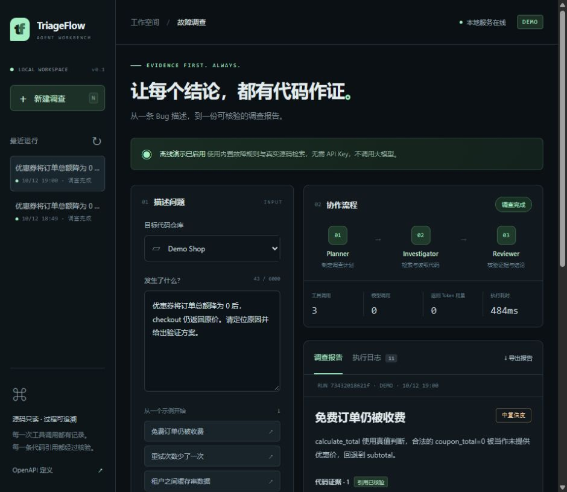
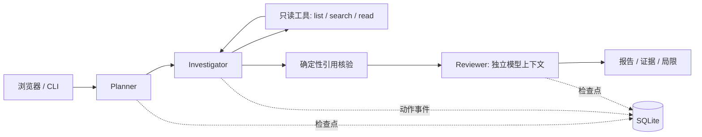

# TriageFlow

**把 Bug 描述变成可核验的代码证据与修复建议。**

Evidence-first bug triage with bounded agents, durable checkpoints, and reproducible evaluation.

Python 3.11+ · FastAPI · SQLite · Tool Calling · MIT

[English](docs/README.en.md) · [架构设计](docs/architecture.md) · [面试与简历](docs/career-guide.zh-CN.md) · [发布到 GitHub](docs/publishing.md)

TriageFlow 是一个面向开发者的本地 Agent 工作台：输入故障描述，Planner 规划调查，
Investigator 调用仓库检索工具，Reviewer 检查证据与结论。最终报告包含源文件、行号、
原文引用、修复建议和待执行的测试计划。界面展示动作日志、预算指标与历史运行。

> 默认 **Demo 模式不调用大模型**，通过确定性规则演示三个内置故障。Live 模式接入支持
> Chat Completions 工具调用的模型后，可分析你配置的本地仓库。项目不会自动修改代码或执行目标测试。



## 5 分钟运行

在项目目录内创建虚拟环境并安装：

```bash
python -m venv .venv
```

Windows PowerShell（无需激活环境）：

```powershell
.\.venv\Scripts\python.exe -m pip install -e ".[dev]"
.\.venv\Scripts\triageflow.exe serve
```

macOS / Linux：

```bash
source .venv/bin/activate
python -m pip install -e ".[dev]"
triageflow serve
```

打开 **[http://127.0.0.1:8000](http://127.0.0.1:8000)**，选择「免费订单仍被收费」并开始分析。
接口定义在 [/openapi.json](http://127.0.0.1:8000/openapi.json)。以下命令假设已激活虚拟环境；
Windows 也可以给 `triageflow` 加上 `.\.venv\Scripts\` 前缀。

```bash
triageflow demo --case coupon --output artifacts/report.md
triageflow demo --case retry
triageflow demo --case cache
triageflow eval --output artifacts/eval-results.json
```

三个场景均读取真实的本地示例文件，并逐条检查引用；未匹配的描述会明确返回证据不足。
不启动服务也可阅读一次实际生成的 [Demo 报告](docs/examples/coupon-report.md)。

## 能展示什么

| 能力 | 具体实现 |
| --- | --- |
| 多角色 Agent 协作 | Planner → 工具调用调查循环 → 独立上下文 Reviewer |
| 有界执行 | 默认 10 调查轮、24 次仓库工具调用、16 次逻辑模型调用；重试也有上限 |
| 证据溯源 | 文件路径、行号、原文同时校验，且必须来自本次任务实际读取的内容 |
| 失败恢复 | SQLite 检查点、原子任务领取、进程重启后恢复；调用预算不清零 |
| 可观测性 | 工具参数/结果、角色阶段、耗时、返回 token 用量、可下载 Markdown 报告 |
| 工具边界 | 只读白名单工具；拒绝路径越界、链接、敏感命名、二进制及超限输入 |
| 可重复评测 | 8 个合成回归用例，区分定位与拒答；持续集成运行离线测试 |
| 可演示产品 | 中文工作台、运行历史、证据片段、步骤日志、失败重试与导出 |

`verified` 只表示**代码引用通过核验**，不表示根因已被证明。模型审阅不认可的结论降为低置信度，
并保留审阅意见。轨迹只记录操作和结果，不展示模型内部思维链。

## 接入真实模型与仓库

复制 `.env.example` 为 `.env`，设置：

```dotenv
TRIAGEFLOW_MODE=live
TRIAGEFLOW_BASE_URL=https://api.openai.com/v1
TRIAGEFLOW_API_KEY=your-key-here
TRIAGEFLOW_MODEL=your-tool-capable-model
TRIAGEFLOW_REPO=/absolute/path/to/your/repository
```

Windows 路径也可写为 `F:/projects/example`。重启 `triageflow serve` 后，在项目下拉框选择本地仓库。
模型必须支持 **Chat Completions + function tools**；兼容接口并不代表所有模型均支持。
需要 Responses API 的模型不能直接用于当前适配器。免认证的本地模型服务可使用占位 API Key。
工具协议参考 [OpenAI 官方 Function Calling 文档](https://developers.openai.com/api/docs/guides/function-calling)。

```bash
triageflow run "Describe the reproducible bug here" --project local --output artifacts/live.md
```

Live 模式会把问题和选中的源码片段发送给配置的模型服务，并可能产生费用。
密钥仅由后端环境变量读取。不要把 `.env`、私有代码或 `.triageflow/` 提交到 GitHub。
本项目已通过模拟模型响应测试；**尚无真实模型准确率或付费接口实测结果**。

## 架构



Demo 使用规则 Planner/Investigator 和确定性 Reviewer；Live 使用模型驱动规划、工具选择、
报告生成与独立审阅。多个角色串行运行，最多允许两个独立任务同时在服务中执行。

```text
src/triageflow/
  engine.py       工作流、预算、引用核验
  providers.py    异步模型接口、重试、协议校验
  repository.py   受限仓库工具
  store.py        SQLite 检查点与事件日志
  api.py / cli.py HTTP 与命令行入口
  evaluation.py  合成回归评测
  web/            无构建依赖的前端
  samples/shop/   故意含 Bug 的演示代码
tests/            工具、模型、流程、恢复与 API 测试
docs/             设计、求职讲解、发布说明
```

## 测试与评测

```bash
python -m pytest -q
python -m ruff check src tests
python -m ruff format --check src tests
triageflow eval
python -m build
```

GitHub Actions 配置 Windows / Ubuntu、Python 3.11 / 3.12 矩阵。第一次推送后再确认远端 CI 状态。
本地依赖快照见 `requirements-dev.lock`；从零重现当前版本可使用
`python -m pip install -r requirements-dev.lock` 后 `python -m pip install -e . --no-deps`。

评测包含 6 个双语故障描述、1 个无关问题和 1 个越界诱导问题。指标是**合成用例中的预期文件定位、
引用核验与证据不足处理**，不评价修复正确性；8/8 通过不能写成真实业务诊断准确率 100%。
真实模型的输出可能不稳定，运行 live 评测需记录模型、版本、用量和失败案例。

## 当前边界与下一步

- 本地单用户、单进程服务；没有登录、多租户隔离、分布式队列或生产部署保证。
- 只读源代码，不自动克隆远端仓库，不执行测试，不生成/应用补丁。
- 文件名过滤不等于秘密检测，路径保护不等于操作系统沙箱；详见 [SECURITY.md](SECURITY.md)。
- 模型解析失败会进入失败状态；可在预算内恢复，不无限重试。
- 后续可扩展 Responses/MCP 适配、符号索引、人工确认修复、隔离测试执行，以及真实问题数据集。

欢迎通过 Issue / PR 贡献。贡献方法见 [CONTRIBUTING.md](CONTRIBUTING.md)。项目使用 [MIT License](LICENSE)。
