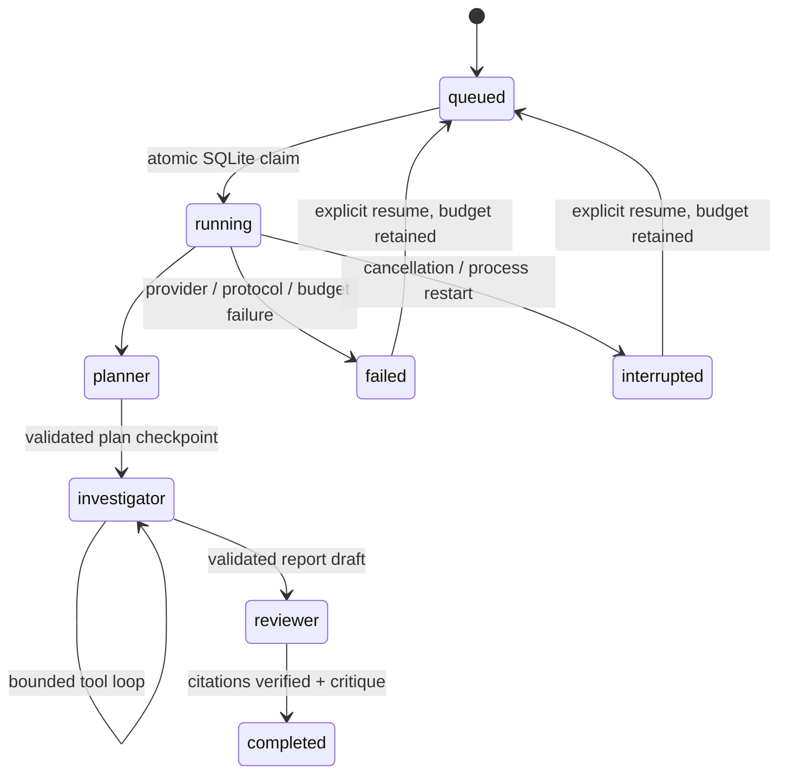

# Architecture and decisions

## Problem

A model can produce a convincing bug explanation without reading the relevant source.
TriageFlow makes tool use, source provenance and failure behavior inspectable. It is a
local engineering reference implementation, not an autonomous code repair service.

## State machine

`status` records the lifecycle; `stage` records the last role. Each run stores the next
stage, plan, inspected excerpts, complete assistant/tool message groups and a report draft.
Budget is reserved before I/O. A claim uses `BEGIN IMMEDIATE` to prevent duplicate execution.
Startup marks unfinished runs interrupted; the user decides which to resume.

Recovery is **at-least-once for a partially finished read-only turn**, not exactly-once
model billing. A crash can lose an uncommitted result after the provider has processed it.
Budgets remain consumed. Complete role checkpoints skip prior roles; incomplete assistant/tool
groups are never replayed as invalid chat protocol. A depleted budget cannot be reset by resume.
Events and checkpoints use separate transactions: the trace can include an action whose turn
will be repeated after a crash. Do not run multiple API workers against the same journal.

## Roles and control

- Planner produces a validated list of 1–6 investigation steps.
- Investigator selects `list_files`, `search`, `read_file` and `submit_report` via real
  function calls in live mode. Tools return data; they do not execute repository code.
- A deterministic validator checks that each citation exists *now*, exactly matches
  its line range and came from this run's inspected excerpts.
- Reviewer gets a fresh context containing only the issue and draft; unsupported
  conclusions are downgraded and the critique becomes a visible limitation.

Reviewer approval is advisory semantic checking, not a proof. No citations always means low
confidence. A valid citation can still be irrelevant or incomplete. Source changes outside
cited lines are not detected as a whole-repository snapshot change. Whole-file SHA-256 values
are recorded with tool reads but are not a repository commit identity.

## Limits and failure policy

| Boundary | Default |
| --- | --- |
| Investigation rounds / logical model calls | 10 / 16, retained on resume |
| Repository tool calls / calls per round | 24 / 8 |
| Provider retries | At most 2 retries per logical call, only transient failures |
| Concurrent HTTP runs | 2, single process |
| API request body | 32,000 bytes including chunked transfers |
| File / excerpt bytes | 256 KiB / 32 KiB |
| Search scan / entry count | 8 MiB / 2,000 entries |
| Returned files / depth / read lines | 400 / 12 / 120 |

Model calls are logical requests, not HTTP attempts. Token counts are reported usage from
successful responses, not a billing ledger; retries or interrupted calls can incur unobserved
cost. Duration accumulates workflow execution time and excludes downtime between resumes.

Each call uses a finite timeout, backoff and payload bounds. Tool errors return a sanitized
message for model correction. Invalid structured plans/reports, malformed provider protocol,
bad evidence and budget exhaustion stop the run. Model refusal/rejection is not converted
into a false success. A reviewer disagreeing with an otherwise valid report yields a low
confidence report with its objection attached.

## Why these choices

1. **Explicit Python state machine over a graph framework for v0.1.** The graph has three
   fixed roles. Plain Python makes checkpoint boundaries and budget tests readable. If
   branching and human approval states grow, a framework can replace the orchestrator.
2. **Lexical source tools over a vector database.** Short bug signatures, identifiers and
   line references are adequate for this demonstrator. Large monorepos need symbols/indexing;
   adding embeddings without a retrieval evaluation would add complexity without evidence.
3. **SQLite over Redis/Celery.** Durable local history with no service dependencies makes
   interviews and contributor setup reproducible. The single-process limitation is explicit.
4. **Vanilla static dashboard.** No Node build required to install the Python package. Browser
   polling reads persisted state and stops on terminal outcomes. This is not token streaming.
5. **Separate offline and live modes.** Contributors can verify engineering invariants without
   credentials. A deterministic regression score is never presented as LLM accuracy.

## Trust boundary

Project roots are configured on the server. The browser and model cannot submit arbitrary
filesystem roots or arbitrary endpoints. Read tools enforce an allowlist and deny symlinks,
reparse points, hidden/sensitive names, binaries and oversized content. Model instructions
are defense in depth; capability restriction provides the stronger boundary. See SECURITY.md
for hard links, filesystem races, source-embedded secrets and local journal retention.

## Validation strategy

- Repository tests: traversal, file policy, real links/junctions, byte/scan budgets and quotes.
- Provider tests: protocol shape, tool args, retries, partial responses, timeout, cancellation.
- Engine tests: real fixture reads, fabricated/unread evidence, budgets, reviewer downgrade.
- Recovery tests: interruption midway through multiple tool calls and fresh Store/Engine resume.
- API tests: full run/export, request validation, hostile origins and chunked body limits.
- Evaluation: 8 synthetic cases, no use of fixtures as a real-world model quality benchmark.

The protocol adapter follows [OpenAI's function calling guide](https://developers.openai.com/api/docs/guides/function-calling).
Only models implementing Chat Completions function tools are compatible with this adapter.
